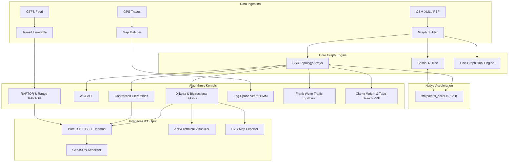
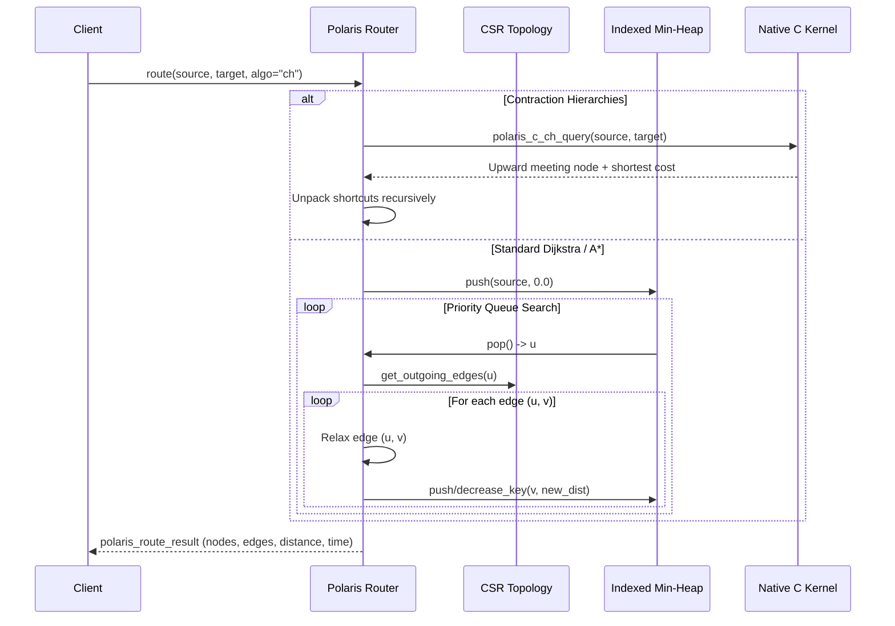

# Polaris Architecture Manual

## 1. System Overview

Polaris is a modular spatial-temporal graph routing, multi-modal mobility, and autonomous logistics engine written in high-performance R with native C acceleration. The engine is engineered around the principle of mechanical sympathy: high-level abstractions coordinate memory-contiguous Compressed Sparse Row (CSR) matrices, spatial partitioning structures (R-Tree, KD-Tree, Geohash, Hexagonal DGGS), and cache-efficient priority queues.

---

## 2. Compressed Sparse Row (CSR) Graph Topology

Polaris represents directed road networks using Compressed Sparse Row (CSR) format to achieve optimal cache locality and eliminate pointer-chasing overhead:

- `node_offset` (integer vector of size $|V| + 1$): Pointer to the beginning of outgoing edges for vertex $i$ in `edge_target`.
- `edge_target` (integer vector of size $|E|$): Contiguous indices of target vertices.
- `edge_weight` (double vector of size $|E|$): Primary edge weight (distance in meters or free-flow travel time in seconds).
- `edge_time` (double vector of size $|E|$): Travel time duration in seconds.
- `edge_id_map` (character vector of size $|E|$): Mapping from internal integer indices to external string identifiers.

For backward graph traversals (such as Bidirectional Dijkstra and backward Contraction Hierarchies search), a parallel Backward CSR index (`bwd_node_offset`, `bwd_edge_target`, `bwd_edge_weight`) is maintained.

---

## 3. Spatial Indexing Hierarchy

Polaris integrates multiple complementary spatial indices tailored for distinct query patterns:

1. Spatial R-Tree (`R/core/spatial_index.R`):
   - Hierarchical bounding box tree using quadratic split heuristics.
   - Primary use: Spatial bounding box queries, candidate road segment retrieval for map matching.
2. K-D Tree (`R/core/spatial_kdtree.R`):
   - 2-dimensional binary space partitioning tree.
   - Primary use: Ultra-fast single nearest neighbor queries and stop-to-stop transit transfer calculations.
3. Geohash Index (`R/core/spatial_geohash.R`):
   - Base-32 string spatial encoding via bit-interleaving latitude and longitude.
   - Primary use: Hierarchical spatial binning and fast spatial prefix hashing.
4. Hexagonal Discrete Global Grid (`R/core/spatial_hex.R`):
   - Axial coordinate $(q, r)$ regular hexagonal tessellation.
   - Primary use: Isotropic spatial aggregation, uniform catchment bins, and directionally unbiased wave propagation.

---

## 4. Shortest Path Routing Execution Flow

---

## 5. End-to-End Map Matching Sequence

When raw sensor traces arrive:
1. Extended Kalman Filter (Optional): Smooths GPS jitter and computes heading estimates.
2. Spatial Candidate Search: The R-Tree queries road segments within radius $R$ (default 50m).
3. Orthogonal Projection: Each GPS ping is projected onto candidate segments, computing cross-track distance and linear along-track position.
4. Emission Likelihood: Evaluated using Gaussian or Student-t distribution based on perpendicular error distance.
5. Transition Likelihood: Network shortest path distances between successive candidate pairs are compared against great circle distance increments.
6. Viterbi Trellis Propagation: Recurrences propagate in log-space, terminating in backward trace recovery of the optimal road sequence.

---

## 6. Public Transit RAPTOR Architecture

Unlike road networks, public transit routing is governed by timetables. Polaris implements RAPTOR (Round-Based Public Transit Routing):
- Round 1: Identifies stops reachable directly by riding 1 transit vehicle.
- Round 2: Explores transfers to identify stops reachable using at most 2 transit trips.
- Round $k$: Extends to $k$ trips until convergence.
- Footpaths: Local walking transfers generated by KD-Tree nearest neighbor queries are relaxed at the end of each round.
- Pareto Frontier: Generates non-dominated itineraries balancing arrival time against transfer count.

---

## 7. HTTP REST Service Daemon

Polaris features an embedded pure-R HTTP/1.1 socket daemon (`R/server/http_server.R`):
- Runs entirely on base R network primitives (`serverSocket`, `socketConnection`).
- Supports RESTful endpoints: `/health`, `/route`, `/match`, `/isochrone`, `/matrix`.
- Automatically sets CORS headers (`Access-Control-Allow-Origin: *`) for browser-based client applications.
- Formats responses directly as GeoJSON FeatureCollections for map visualization in Leaflet, Mapbox GL, or Kepler.gl.
